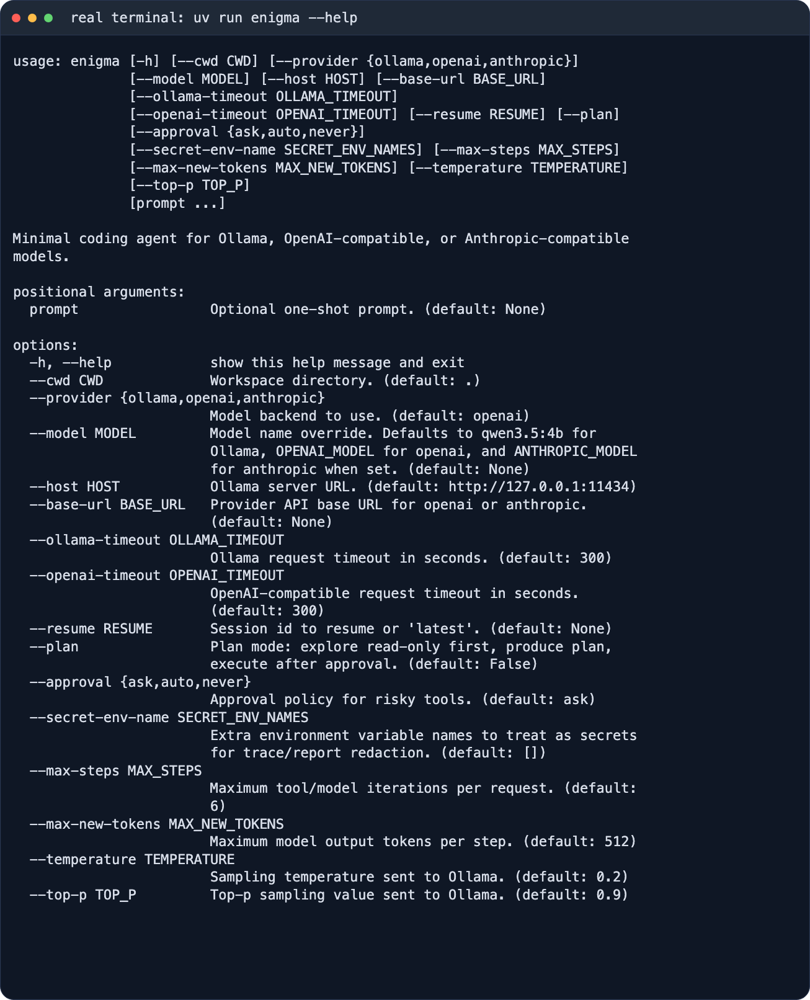
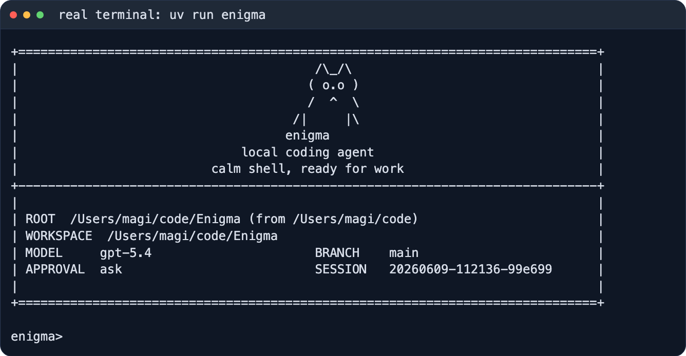
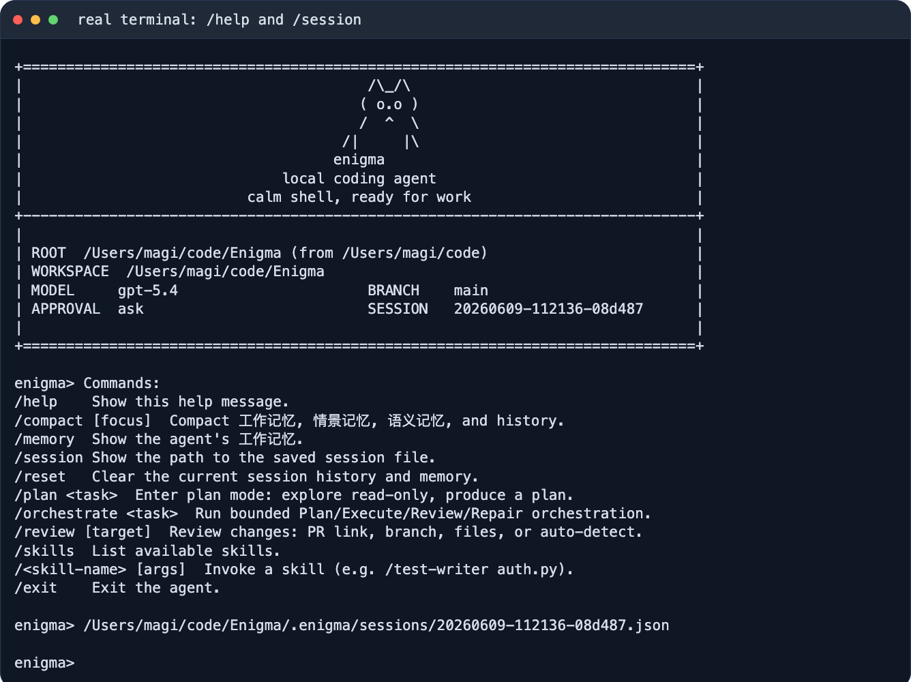

# Enigma

Enigma 是一个面向本地代码仓库的轻量级 coding agent。它运行在终端中，能够读取当前工作区、调用受约束的工具、执行一次性工程任务或进入交互式 REPL，并把会话、记忆和运行产物保存在本地。

这个项目的重点不是做一个聊天壳，而是实现一个可解释、可测试、可恢复的 agent runtime：从 CLI 参数解析、模型后端适配、上下文预算管理，到工具安全校验、会话持久化和跨会话记忆，都尽量保持清晰的模块边界。

## 项目亮点

- **多模型后端**：支持 Ollama、OpenAI 兼容 Responses API、Anthropic 兼容 Messages API。
- **仓库感知工作流**：启动时采集 Git 状态、项目文档、目录结构和最近提交，用于构建当前任务上下文。
- **【本轮面试补强】Harness policy 硬约束**：把 UTF-8 读写、workspace 路径锚定、危险工具审批等确定性规则放在工具层，而不是依赖 prompt 提醒。
- **受控工具执行**：对 glob、搜索、轻量 symbol search、文件读写、shell 执行和委派等工具做路径校验、审批策略、重复调用检测和密钥脱敏。
- **显式 coding loop**：系统 prompt 要求按 `search/list/glob -> read -> reason -> edit/patch -> test/check -> observe -> revise` 推进代码修改，Plan 模式使用只读版探索闭环。
- **【本轮面试补强】工程化记忆系统**：工作记忆减少重复探索，情景记忆保留失败和执行节点，语义记忆记录跨会话稳定事实及其适用场景。
- **上下文预算管理**：按模型上下文窗口动态设置 prompt budget，并在超限前压缩 history、工具结果和记忆片段。
- **【本轮面试补强】Plan / Execute / Review / Repair 编排**：`/orchestrate` 通过固定角色和有限状态转移形成轻量多智能体闭环。
- **Plan / Review / Skills**：内置 `/plan` 只读规划、`/review` 代码审查、`/skills` 技能加载等面向工程任务的命令。
- **可追踪运行产物**：每次任务生成 `task_state.json`、`trace.jsonl`、`report.json`，便于复盘和调试。
- **测试覆盖完整**：围绕 runtime、记忆、上下文管理、安全约束、技能系统、审查流程和 session DB 编写了单元测试。

## Problem → Design → Evidence

Enigma 的定位不是“复刻一个聊天壳”，而是一个面向本地仓库任务的 coding agent harness。核心问题和对应设计如下：

- **长任务重复探索**：模型容易反复读取同一批文件，也容易忘记已经验证过的事实。Enigma 用工作记忆保存当前任务、recent files 和带 freshness 的文件摘要，用相关记忆召回减少重复工具调用。
- **工具边界不应只靠 prompt**：编码、路径和危险操作审批是确定性规则。Enigma 用 `HarnessPolicy` 和工具校验层保证 UTF-8 读写、workspace 锚定、risky tool 审批，而不是要求模型每次“记得遵守”。
- **工具链需要覆盖常见 coding agent 闭环**：除了 `list_files`、`search`、`read_file`、`write_file` / `patch_file` 和 `run_shell`，Enigma 还补了 `glob` 和轻量 `symbol_search`，让模型能先定位文件和定义，再读取、修改、测试和修复。
- **长期记忆需要触发场景**：语义记忆不只保存一句话，还可以保存 `problem` 和 `applies_when`，让 agent 知道这条约定未来在什么场景下用于解决什么问题。
- **计划、执行、审查需要闭环**：单个模型循环很难区分计划错、执行错还是审查发现新风险。`/orchestrate` 把 Planner、Executor、Reviewer、RepairPlanner 拆成固定角色，用状态转移和 retry limit 控制交互。

这些设计都写入 `trace.jsonl` / `report.json`，并由 pytest 覆盖典型边界：路径逃逸、只读规划、记忆召回、review 阻断、repair 重试和 retry abort。

## 本轮面试补强改动

这一轮改造来自一次项目面试复盘。面试官的核心质疑不是“功能少”，而是项目需要说清楚真实 coding agent 痛点、工程边界和最小有效改造。因此本轮没有引入重型框架，而是围绕 harness 能力做了四个有边界的增强。

| 面试官指出的问题 | 本轮改进 | 可展示证据 | 面试时怎么回应 |
| --- | --- | --- | --- |
| 设计像功能复刻，没有从真实 coding 痛点出发 | README 改成 `Problem → Design → Evidence` 叙事，强调重复探索、工具边界、长任务闭环和跨会话教学成本 | 本 README 的问题映射；`.enigma/runs/<run_id>/trace.jsonl` / `report.json` | “我后来把项目从功能清单收敛成 coding agent harness，重点解释每个模块解决的真实问题。” |
| 能用工具层约束解决的问题，不应只写 prompt | 新增 `HarnessPolicy` / `ToolPolicy`，把 UTF-8、workspace path、risky tool 审批、plan mode 工具过滤放到确定性策略层 | `enigma/policy.py`、`enigma/tools.py`、`tests/test_safety_invariants.py`、`tests/test_plan_mode.py` | “prompt 是软约束。路径安全、编码和审批这种规则应该由 harness 保证，而不是靠模型记住。” |
| 工具面和流程没有完整对齐 coding agent 常见闭环 | 新增 `glob`、轻量 `symbol_search`，并在正常/Plan prompt 中显式写入定位、读取、修改、测试、观察、修复流程 | `enigma/tools.py`、`enigma/runtime.py`、`tests/test_enigma.py` | “我没有只在文档里说 workflow，而是补了模型可调用的文件定位和符号定位工具，并把闭环写进系统 prompt。” |
| 记忆系统说不清什么时候触发、解决什么问题 | durable memory 增加 `problem` 和 `applies_when`，召回时把适用场景展示给模型 | `enigma/memory.py`、`enigma/context_manager.py`、`tests/test_memory.py` | “长期记忆不只存文本，还存未来什么时候用它。这样才能解释记忆为什么会被召回。” |
| multi-agent 不能只是线性流水线 | 新增 `/orchestrate`：Planner / Executor / Reviewer / RepairPlanner 固定角色，支持执行失败和 review finding 回到 RepairPlan，带 retry limit | `enigma/orchestration.py`、`enigma/cli.py`、`tests/test_orchestration.py` | “它不是开放 swarm，而是 bounded orchestration。角色边界、工具边界和状态转移都很清楚。” |
| 项目缺少可验证证据 | 新增 orchestration、policy、memory 相关测试，并跑通真实 Ollama 调用链 | `231 passed`、`ruff check`、真实 `/orchestrate` 输出 | “我没有只写 README，补了回归测试和一次真实模型调用，能展示状态机确实完成闭环。” |

### 本轮新增或重点修改的文件

- `enigma/policy.py`：本轮新增，承载 harness / tool policy 的确定性规则。
- `enigma/orchestration.py`：本轮新增，实现 Plan / Execute / Review / Repair 状态机。
- `enigma/cli.py`：本轮修改，新增 `/orchestrate <task>` 命令入口。
- `enigma/memory.py`：本轮修改，durable memory 支持 `problem` 和 `applies_when`。
- `enigma/context_manager.py`：本轮修改，召回记忆时展示适用场景。
- `enigma/tools.py`：本轮修改，将 risky tool 与审批、plan mode 工具面进一步对齐。
- `enigma/runtime.py`：本轮修改，在正常模式和 Plan 模式 prompt 中明确 coding loop，并暴露 `glob` / `symbol_search` 示例。
- `tests/test_orchestration.py`：本轮新增，覆盖正常路径、repair、review 阻断、retry abort、只读 reviewer 工具面和 trace。
- `tests/test_memory.py`、`tests/test_plan_mode.py`、`tests/test_safety_invariants.py`：本轮补强，覆盖 applies_when、plan mode 工具限制和策略边界。

### 本轮真实验证

本轮验证包括单元测试、静态检查和真实模型调用。

```bash
uv run pytest -q
# 231 passed

uv run ruff check .
# All checks passed!

uv run enigma --provider ollama --model qwen3.6:35b-a3b --approval never --max-steps 4 --max-new-tokens 512 \
  "请先调用 read_file 工具读取 README.md 的第 1 到 20 行，然后根据工具结果用中文简要总结这个项目是什么。必须先调用工具，不要直接回答。"
# 真实链路：model -> read_file tool -> model -> final

uv run enigma --provider ollama --model qwen3.6:35b-a3b --approval never --max-steps 6 --max-new-tokens 700 \
  "/orchestrate 只读检查 README.md 的项目定位，并给出是否符合 coding agent harness 叙事的简短结论。不要修改任何文件。"
# Orchestration complete.
# - state: DONE
# - retries: 0/2
# - steps: 3
# - review_findings: 0
```

实机测试也暴露了一个真实模型行为：`qwen3.6:35b-a3b` 有时会重复工具调用或重复输出 `<final>`。当前 runtime 的重复工具调用防护可以拦截相同工具调用，`/orchestrate` 的状态机也能收敛到 `DONE`。本轮因此调整了计划步骤解析，只把 `## Steps` 中的顶层步骤作为 active step，避免把缩进说明和风险列表误当成多个执行步骤。

## 面试回答口径

**项目总述**：Enigma 是一个本地 coding agent harness。它不是训练大模型，也不是单纯聊天壳，而是在应用层解决 agent 如何安全、稳定、可追踪地完成本地仓库任务。

**为什么不是只靠 prompt**：prompt 是软约束。UTF-8、路径锚定、危险工具审批、plan mode 只读工具面这些确定性规则，应该落到 harness policy 和工具层。

**记忆系统解决什么问题**：工作记忆减少重复探索，情景记忆帮助长任务恢复和失败追踪，语义记忆减少跨会话重复教学。本轮给长期记忆加了 `applies_when`，让 agent 知道这条记忆未来在什么场景下该被召回。

**这算不算 multi-agent**：它不是开放式 swarm，而是 bounded multi-agent orchestration。Planner、Executor、Reviewer、RepairPlanner 有固定职责和状态转移；执行失败或审查不通过会回到 RepairPlanner，超过 retry limit 会 abort。

**为什么适配 Apple LLM/Agent Intern**：这个项目对应 LLM/Agent practical applications、multi-agent systems、backend integration、performance and efficiency。它展示的是 agent harness 的工程化能力：工具边界、状态机、记忆召回、trace/report 和真实调用验证。

## 使用截图

当前版本 CLI 帮助信息：



当前版本启动界面：



当前版本 REPL 内置命令与会话路径：



## 技术栈

- Python 3.10+
- 标准库优先的实现风格
- `setuptools` 构建与 console script 入口
- `pytest` 测试
- `ruff` 静态检查
- SQLite / FTS5 用于跨会话检索与摘要存储

## 项目结构

```text
enigma/
  cli.py              # CLI 参数解析、模型后端选择、REPL 启动
  runtime.py          # Agent 控制循环、工具调度、trace 与记忆更新
  models.py           # Ollama / OpenAI-compatible / Anthropic-compatible 客户端
  policy.py           # HarnessPolicy / ToolPolicy：确定性工具规则
  orchestration.py    # Plan / Execute / Review / Repair 状态机编排
  tools.py            # 文件、glob、搜索、symbol search、shell、委派等工具实现
  context_manager.py  # prompt 预算、压缩与上下文组装
  memory.py           # 分层记忆、文件摘要 freshness、语义记忆
  workspace.py        # Git 与工作区快照
  storage/            # SessionDB 与持久化存储
  skills/             # 内置技能模板
tests/                # pytest 测试套件
docs/                 # 架构说明与面试速查材料
assets/screenshots/   # README 截图素材
```

更完整的实现拆解见 [docs/agent-assembly.md](docs/agent-assembly.md)。

## 安装

需要 Python 3.10 或更高版本。

使用 `uv`：

```bash
uv sync
```

或使用普通 Python 环境：

```bash
pip install -e .
```

安装后会注册 `enigma` 命令，也可以通过模块方式启动：

```bash
python -m enigma
```

## 快速开始

在当前仓库中启动交互模式：

```bash
uv run enigma
```

指定工作目录：

```bash
uv run enigma --cwd /path/to/repo
```

执行一次性任务：

```bash
uv run enigma "inspect the test failures and propose a fix"
```

进入只读规划模式：

```bash
uv run enigma --plan "add tests for the memory module"
```

## 模型后端配置

### Ollama

```bash
ollama serve
ollama pull qwen3.5:4b
uv run enigma --provider ollama --model qwen3.5:4b
```

### OpenAI 兼容接口

```bash
export OPENAI_API_BASE="https://your-api.example/v1"
export OPENAI_API_KEY="your-api-key"
export OPENAI_MODEL="gpt-5.4"
uv run enigma --provider openai
```

### Anthropic 兼容接口

```bash
export ANTHROPIC_API_BASE="https://your-api.example/v1"
export ANTHROPIC_API_KEY="your-api-key"
export ANTHROPIC_MODEL="claude-sonnet-4-6"
uv run enigma --provider anthropic
```

`enigma` 会对常见密钥环境变量做脱敏处理，也可以通过 `--secret-env-name` 或 `ENIGMA_SECRET_ENV_NAMES` 追加需要保护的变量名。

## 常用命令

交互式 REPL 中支持：

- `/help`：查看内置命令
- `/plan <task>`：进入只读探索与计划审批流程
- `/orchestrate <task>`：运行 Plan / Execute / Review / Repair 轻量编排
- `/review [target]`：审查当前变更、指定分支、PR 链接或文件
- `/skills`：列出可用技能
- `/compact [focus]`：压缩工作记忆、情景记忆、语义记忆和 history
- `/memory`：查看当前记忆摘要
- `/session`：查看当前 session 文件路径
- `/reset`：清空当前 session 状态
- `/exit` 或 `/quit`：退出 REPL

## 安全与持久化

Enigma 默认把高风险操作放在审批策略之下：

```bash
uv run enigma --approval ask
uv run enigma --approval auto
uv run enigma --approval never
```

本地运行状态会写入 `.enigma/`，包括：

- `.enigma/sessions/`：会话 JSON
- `.enigma/runs/<run_id>/task_state.json`
- `.enigma/runs/<run_id>/trace.jsonl`
- `.enigma/runs/<run_id>/report.json`

这些内容包含本地运行轨迹，已在 `.gitignore` 中排除，不会随仓库提交。

## 开发与测试

运行测试：

```bash
python -m pytest -q
```

运行静态检查：

```bash
python -m ruff check enigma tests
```

如果使用 `uv`，也可以写成：

```bash
uv run pytest -q
uv run ruff check enigma tests
```

## 设计取舍

Enigma 保持较少的外部依赖，核心逻辑尽量由标准库实现，便于阅读、调试和面试时讲清楚。项目目前更适合作为本地 agent runtime 与工程化能力展示，而不是面向普通用户的完整商业产品。

主要取舍包括：

- 优先保证工具执行可控和可追踪，而不是追求最大权限自动化。
- 使用结构化 trace 与 report 保存运行现场，方便复盘。
- 将模型协议、上下文管理、记忆系统和工作区操作拆成独立模块，降低单点复杂度。
- 测试覆盖安全边界和状态恢复等容易出错的路径。

## 来源与致谢

本项目基于 Gitee 项目 [htxoffical/pico](https://gitee.com/htxoffical/pico/tree/main) 进行学习、整理与改进，主要用于个人工程实践与实习应聘作品展示。感谢原作者的开源分享与项目基础。

在此基础上，本仓库对项目命名、README 展示、Git 忽略规则、文档材料和部分工程结构进行了整理，使其更适合作为可阅读、可复现、可交流的作品集项目。

## 当前状态

项目处于原型完善阶段，核心 CLI、runtime、记忆、上下文管理、审查命令和技能系统已经具备可运行实现。后续可以继续补充端到端示例、更多 provider 兼容性测试，以及更友好的安装发布流程。注意:目前进行过多次修改,可能发生无法启动的问题,需要后续测试。
